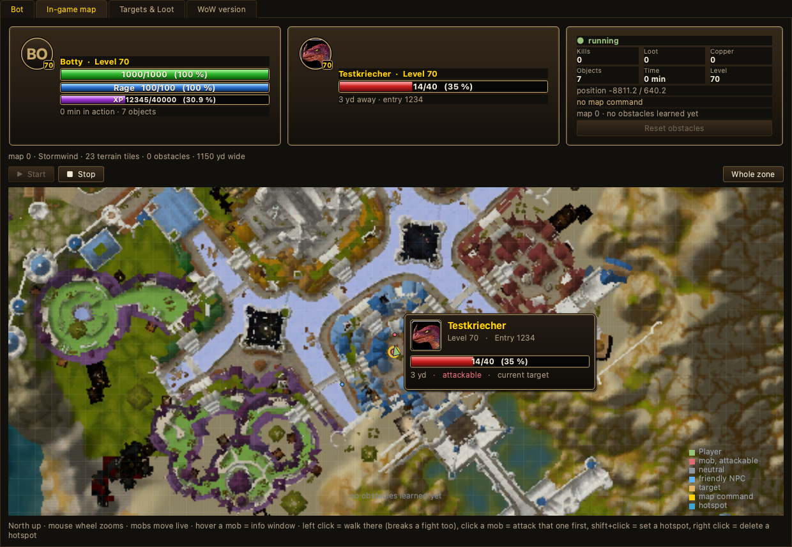
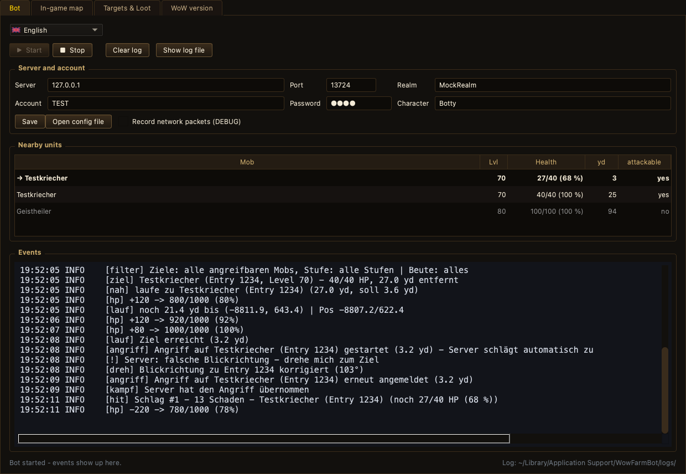
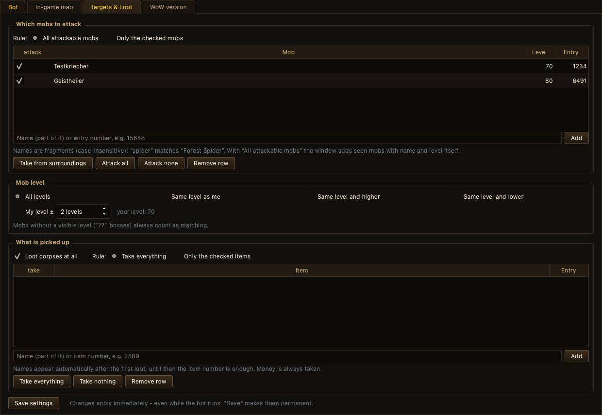
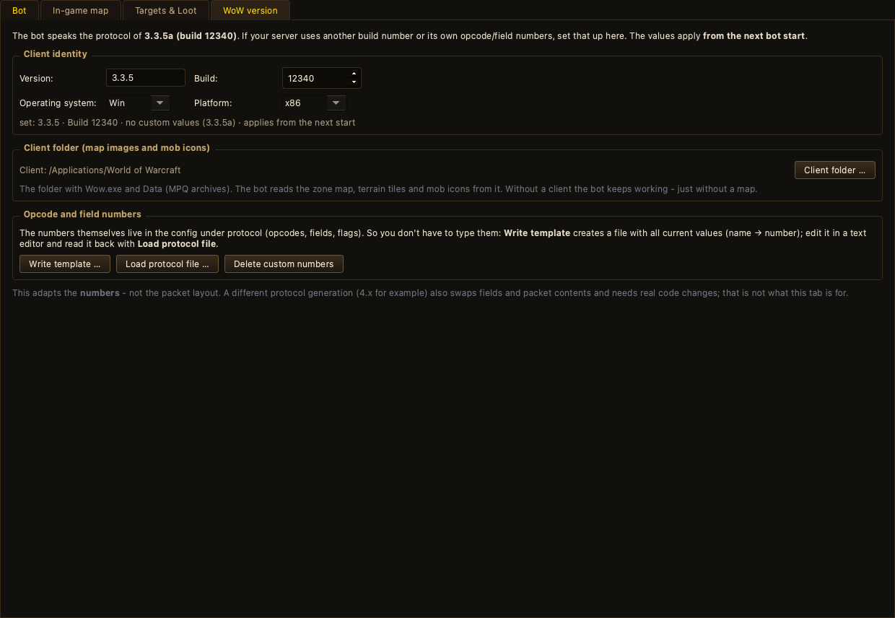

# WoWFarmBot

A headless farming bot for **World of Warcraft 3.3.5a (build 12340)** with a WoW-styled
control panel. It never starts `Wow.exe` and never touches the client — it speaks the
server's own network protocol: SRP6 login, encrypted world session, character login,
find mobs, walk there, fight, loot, rest. Because of that it runs anywhere Python runs,
while you play the very same account in your real client on the side.



## Download

Ready to run, no Python needed — see [Releases](https://github.com/myjumperlp-byte/wow-farmbot/releases/latest):

| File | System |
| --- | --- |
| `WowFarmBot-windows-x64.zip` | Windows 10/11 (64 bit) — unzip, run `WowFarmBot.exe` |
| `WowFarmBot-macos-arm64.zip` | macOS on Apple Silicon — unzip, open `WowFarmBot.app` |

Both builds are unsigned. On Windows, SmartScreen shows *More info → Run anyway*.
on macOS, right-click the app and choose *Open* the first time.

Every release is built by GitHub Actions from the tagged commit (see
[build.yml](.github/workflows/build.yml)), so the binaries match the source.

## What it can do

**Farming loop**
- Finds attackable units from the server's object updates (position, health, level, entry), walks to them, fights with melee and/or spells, loots money and items, rests when low.
- Skips non-targets: vendors, trainers, spirit healers, `UNIT_FLAG_NON_ATTACKABLE`/`IMMUNE_TO_PC` units.
- If no mob is in range it walks to the next *known* mob (chase radius) instead of wandering off, and falls back to roaming your hotspots.
- Full loot queue: every corpse in range, gold plus items, repeat attempts on locked corpses, foreign kills after the server frees them.
- Auto-attack, real hit lines (damage, crit, block, miss, dodge) read from `SMSG_ATTACKERSTATEUPDATE` — no HP-difference guessing.
- Rest phase: sits down, reports HP every 10 s, uses heal spells, potions, food and drink until HP/mana are back; a 50 %-HP heal cast in combat, then two casts — and it always finishes a fight before it rests.

**Pathfinding** (`wowbot/wayfinder.py`, `wowbot/terrain.py`)
- Terrain ahead of time: the client's ADT tiles give heights (MCVT) and water (MCLQ), so cliffs and deep water are avoided instead of learned the hard way.
- Local obstacle map: routes the server rejected are remembered per map and A* routes around them, with smoothed paths, side-stepping and replanning.
- Learned obstacles are stored per map and reloaded after a restart.

**Maps & HUD**
- Real client maps: zone maps (`Interface\WorldMap\…`, 4×3 stitched, calibrated via `WorldMapArea.dbc`) plus minimap terrain tiles — pixel-accurate, so player, mobs and obstacles sit 1:1 on the map.
- WoW-style HUD: player frame (portrait, level, HP/mana/XP bars), target frame (icon, name, level, HP, distance), counter frame (kills, loot, copper, objects, time, position, obstacles).
- Live mob positions from `SMSG_MONSTER_MOVE` — mobs walk across the map instead of freezing.
- Hover a mob for an info window: icon, name, level, HP, distance, state (`attackable` / `neutral` / `friendly NPC`) and whether your rules make it a target.
- Colours and legend: green = you, red = attackable mob, grey = neutral, blue = friendly NPC, yellow = target, gold = map command, numbered = hotspot.
- Click commands: left click = walk there (even mid-fight, cancels the fight), click a mob = attack that one first, shift+click = set a hotspot, right click = delete one.

**Filters** (`wowbot/filters.py`) — tab "Targets & Loot"
- Mob rules: attack all attackable mobs, or only the checked ones — by name fragment, entry or both.
- Level filter relative to your own level: all, same, same and higher, same and lower, or my level ±N.
- Loot rules: take everything, only checked items, or exclude individual items by name fragment or item ID. Money is always taken.
- Changes apply to the running bot immediately — no restart; a target that the new rules exclude is dropped at once.

**Death recovery**
- Remembers the death position (every death overwrites it), waits briefly for a resurrection, otherwise releases the spirit.
- Confirms the graveyard teleport (without that the server ignores all movement), ghost-runs back to the remembered spot and reclaims the corpse; if that fails it walks to the spirit healer and runs back from there.
- Heals up at the corpse, then keeps farming.

**Bilingual interface** (`wowbot/i18n.py`)
- Language picker top left with flag: German and English, switches the whole window live (tabs, labels, tooltips, table headers, map legend, info windows) without a restart.
- The choice is stored in the config as `language`.

**Adapt to your core** (`wowbot/protocol_profile.py`) — tab "WoW version"
- Client version, build, OS/platform plus custom **opcode, field and flag numbers** (config section `protocol`) for 3.3.5a cores with their own numbering.
- Writes a template with all 129 numbers and reads it back; unknown names, wrong groups and out-of-range values are rejected.
- This adapts *numbers*, not the packet layout — a different protocol generation needs real code changes.





## Requirements

- Python 3.9 or newer
- `PySide6` (window), `Pillow` (map and icon images), `mpyq` (reads the client's MPQ archives for zone maps) — the headless bot itself only uses the standard library
- A server that accepts build 12340 (3.3.5a)

Tested on macOS; the bot is plain sockets and asyncio, so Linux and Windows work the same.

## Quick start

**With the window**

```bash
python3 -m venv .venv
.venv/bin/pip install PySide6 Pillow mpyq
.venv/bin/python gui.py
```

Enter server, account and password, press **Start**. The window's own config lives in
`~/Library/Application Support/WowFarmBot/config.json` (on the first start it is copied
from the project folder). To build a double-clickable app:

```bash
.venv/bin/python -m PyInstaller --windowed --name WowFarmBot gui.py
```

**In the terminal**

```bash
cp config.example.json config.json
# edit config.json: password, optionally character name and hotspots
python3 run_bot.py config.json
```

If `password` is empty the bot asks for it at start (so it never lands in the file).
Without `character` it takes the highest-level character on the account. The login
server address, realm name and world address are read from your config; the world
address is normally taken from the realm list.

**Try it without a server.** `tools/mock_server.py` is a small mock that speaks just
enough 3.3.5a for the bot to run through everything: SRP6, realm list, encrypted auth
session, character list, world entry, mobs, combat, loot — and death including the
graveyard teleport.

```bash
python3 tools/mock_server.py --rounds 2     # terminal 1
python3 run_bot.py config.mock.json         # terminal 2
```

## Configuration

`config.example.json` lists every option; the window's tabs write the same file, so you
can either edit JSON or use the UI. The important ones:

| Field | Meaning |
| --- | --- |
| `server.host` / `auth_port` / `realm` | login server and realm name |
| `account.username` / `account.password` | account data |
| `character` | character name; empty = highest level |
| `language` | `de` or `en` — interface language |
| `map.client` | WoW folder (map images, terrain tiles, mob icons) |
| `behavior.hotspots` | `[{"x":…, "y":…, "z":…}]` to roam between |
| `behavior.mob_filter_mode` / `mob_rules` | `all` or `only` + rules from the "Targets & Loot" tab |
| `behavior.mob_level_mode` / `mob_level_spread` | `all`, `same`, `same_or_higher`, `same_or_lower`, `range` (±N) |
| `behavior.loot_mode` / `loot_rules` | `all` or `only` + item rules |
| `behavior.rest_hp_pct` / `rest_until_hp_pct` | rest below 30 % HP, continue at 95 % |
| `behavior.heal_spell_ids` / `heal_hp_pct` / `combat_heal_hp_pct` | self-heal in rest (45 %) and in combat (50 %) |
| `behavior.potion_entry` / `food_entry` / `drink_entry` | consumables used while resting |
| `behavior.corpse_run_back` / `auto_release` | death recovery behaviour |
| `behavior.terrain_aware` / `terrain_max_slope` / `terrain_water_depth` | terrain use in pathfinding |
| `behavior.path_storage` | folder for learned obstacles (default `~/Library/Application Support/WowFarmBot/nav`) |
| `behavior.status_seconds` / `nearby_list_count` | log cadence and how many nearby mobs are listed |
| `protocol.version` / `build` / `os` / `platform` / `opcodes` / `fields` / `flags` | client identity and custom numbers |

## Log

Every event is one line with a tag: `[suche]`, `[lauf]`, `[ziel]`, `[angriff]`, `[hit]`,
`[zauber]`, `[dreh]`, `[hp]`, `[kampf]`, `[kill]`, `[loot]`, `[xp]`, `[level]`, `[rast]`,
`[tod]`, `[zurück]`, `[umweg]`, `[status]`, `[teleport]` and `[!]` for server errors.
`--log-packets` also dumps every packet with opcode and size. After each kill there is a
combat block with duration, hits, misses, total damage and the XP gained.

## Limits (on purpose)

- **No full navmesh.** Terrain (slopes, water) is known ahead of time, objects are not:
  trees, rocks, buildings, fences and doors are separate models in the MPQs and not part
  of the height data. The bot routes around them once it got stuck. Indoors and between
  doodads it is trial and error, so keep hotspots on open ground.
- **No vendor, repair or inventory management.** Bags fill up eventually.
- **No quests, chat or trading.**
- Servers with active Warden/DOS protection may refuse the login; in TrinityCore 3.3.5
  Warden is not implemented by default.
- The bot is only as good as your server's object updates. If creature positions are
  updated rarely, targets look slightly stale.

## Notes

- The interface is German/English, switchable live. The bot's **event log lines are still
  German** — translating them is the next piece of work.
- The interface is bilingual by design; the code's source language for UI strings is German.

## Legal / fair play

This is meant for **your own** private server. On someone else's server automated play
violates the terms of service and can get you banned — even though technically only the
normal client protocol is spoken.
